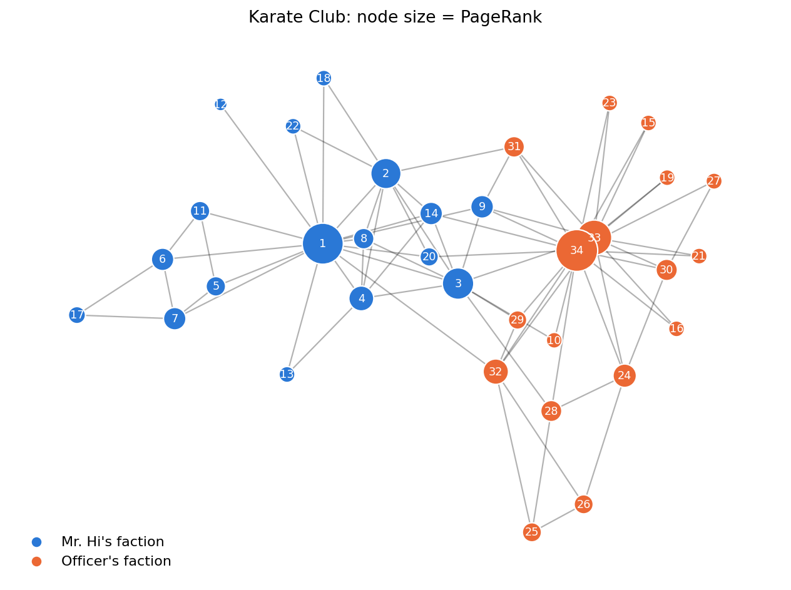

# PageRank on Three Networks

**CSE4039 Advanced Text & Social Media Analytics · Web Analytics project · VIT-AP University**
Swapnil (23BCB7031) · Shashikant (23BCB7077)

PageRank implemented from scratch (power iteration), verified against NetworkX, and applied to Zachary's Karate Club and a 100K-page Wikipedia link graph.

## Links

| | |
|---|---|
| 📊 Presentation | [`presentation/`](https://github.com/swappy1409/atsma-project/tree/main/presentation) · [PageRank_Presentation.pdf](presentation/PageRank_Presentation.pdf) |
| 🖥️ Demo application | [`demo-app/`](https://github.com/swappy1409/atsma-project/tree/main/demo-app) · download [`index.html`](demo-app/index.html) and open it in a browser |
| 🎬 Demo video | [`video/`](https://github.com/swappy1409/atsma-project/tree/main/video) · [PageRank_Demo_Video.mp4](video/PageRank_Demo_Video.mp4) (4:04) · [subtitles](video/PageRank_Demo_Video.srt) |
| 📄 Report (PDF) | [`docs/`](https://github.com/swappy1409/atsma-project/tree/main/docs) · [PageRank_Project_Report.pdf](docs/PageRank_Project_Report.pdf) |
| 📓 Notebook | [`PageRank_Web_Analytics.ipynb`](PageRank_Web_Analytics.ipynb) |
| 🐍 Source code | [`src/`](https://github.com/swappy1409/atsma-project/tree/main/src) · [pagerank_web_analytics.py](src/pagerank_web_analytics.py) |
| 📥 Input data | [`data/`](https://github.com/swappy1409/atsma-project/tree/main/data) |
| 🔄 Intermediate data | [`intermediate/`](https://github.com/swappy1409/atsma-project/tree/main/intermediate) |
| 📈 Output data & charts | [`outputs/`](https://github.com/swappy1409/atsma-project/tree/main/outputs) |

## Results

| network | nodes | links | iterations | max \|ours − NetworkX\| |
|---|---:|---:|---:|---:|
| Karate Club | 34 | 78 | 45 | 1.5e-9 |
| Wikipedia 100K | 99,998 | 8,572,670 | 61 | 1.0e-7 |



## Run

```bash
pip install -r requirements.txt
jupyter notebook PageRank_Web_Analytics.ipynb   # Run All
```
Wikipedia data: see [`data/README.md`](data/README.md).
